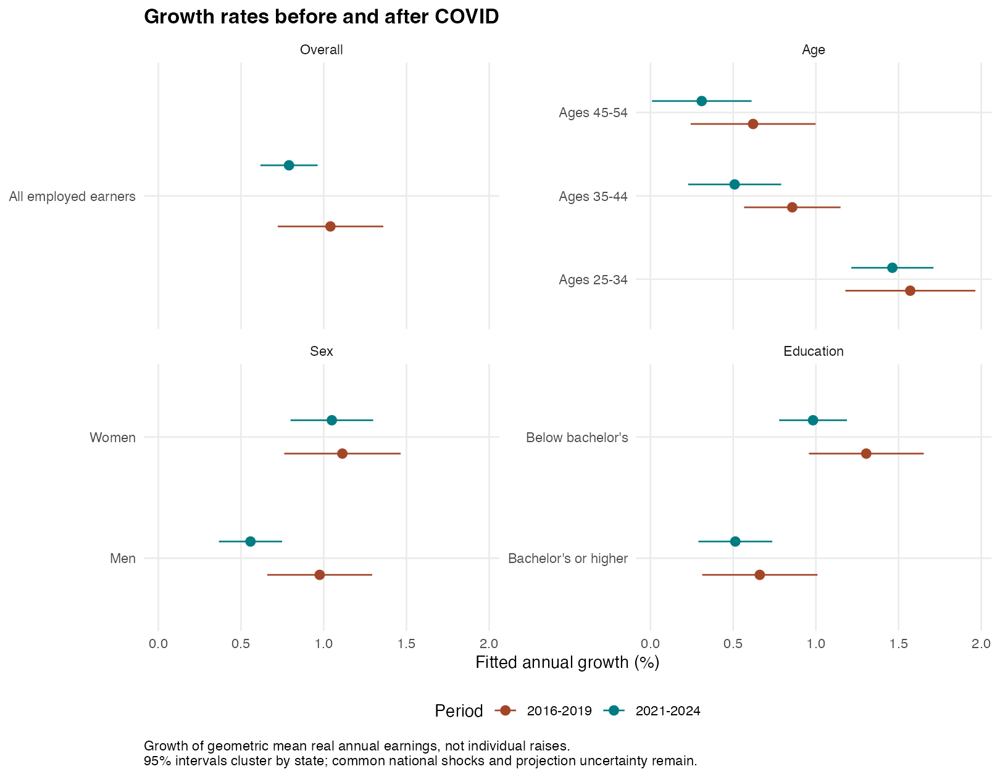

# Post COVID Wages

This project studies how real annual earnings changed after COVID. It compares growth from 2016 to 2019 with growth from 2021 to 2024, looking at age, sex and education. Stata handles the data and regressions; R makes the figures.

The main question is whether earnings grew faster than they had before. For example, workers ages 25 to 34 had estimated annual growth of 1.57% before COVID and 1.46% afterward. They still grew faster than older workers, but that difference was already present before the pandemic.



The analysis accounts for inflation and keeps the mix of ages, sexes, degree status and states the same as in 2019. It also checks how the results change with different years and sample choices. These comparisons describe earnings patterns; they do not prove that COVID caused them. Read the [research summary](research_summary.md) for the findings and what they mean.

## Data

The project uses public American Community Survey data from [IPUMS USA](https://usa.ipums.org/usa/). Select the individual annual ACS samples for 2016, 2017, 2018, 2019, 2021, 2022, 2023 and 2024. Do not select the combined five year samples. There are no 2020 or 2025 observations in this extract.

Include these variables:

```text
YEAR SAMPLE SERIAL PERNUM AGE SEX RACE EDUC EDUCD EMPSTAT
STATEICP PERWT INCWAGE UHRSWORK WKSWORK1
```

Choose Stata format and follow the IPUMS import instructions. Place the resulting dataset here:

```text
data/raw/usa_00001.dta
```

The scripts expect lowercase variable names after import. Exact weeks worked is not available for every year, so the project uses annual earnings rather than calculating hourly pay. The main sample includes about 7.1 million records of employed people ages 25 to 54 with positive wage income. These are different people each year, not individual workers tracked over time.

The code converts earnings to 2024 dollars using the Consumer Price Index. Do not apply another inflation adjustment to the extract beforehand. Income covers the previous 12 months, so the adjustment is approximate. Details are available in the [income definition](https://usa.ipums.org/usa-action/variables/INCWAGE), [income timing guidance](https://usa.ipums.org/usa/acsincadj.shtml), and [price index table](https://www.bls.gov/regions/mid-atlantic/data/consumerpriceindexannualandsemiannual_table.htm).

## Running the project

The main folder contains the README, research summary, `code`, `data` and `outputs`. The run file and optional checks are inside `code`.

Use Stata 16 or newer and R. Install the R packages once:

```r
install.packages(c("ggplot2", "haven", "data.table"))
```

Only `ggplot2` is needed for the figures. The other two packages are used for the optional data checks.

In Stata, replace the placeholder below with the location of your project folder:

```stata
cd "PATH/TO/post-covid-wages"
do code/run_project.do
```

This runs the analysis and calls R to make the figures without opening RStudio. If Stata cannot find Rscript, give it the location of that program:

```stata
do code/run_project.do "/PATH/TO/Rscript"
```

You can also run the steps separately in Stata:

```stata
do code/00_setup.do
do code/01_build_data.do
do code/02_analysis.do
```

Then run this from a terminal in the project folder:

```text
Rscript code/03_figures.R
```

The scripts are written for the eight listed years. Adding years requires updating the inflation values, comparisons and checks, not just replacing the raw file.

## Results and checks

The six figures are saved in `outputs/figures`, and the tables are saved in `outputs/tables`. The [results report](outputs/tables/research_results.md) updates automatically when the R script runs. The research summary is a separate written interpretation and needs to be reviewed when results change. Raw and processed survey data stay local; only combined results are published.

The optional method details at the bottom of this README explain the regressions, weights and limits. They stay collapsed so you can read the main findings without working through every statistical detail.

To check the calculations after running the project, run `do code/checks/trend_algebra.do` in Stata and `Rscript code/checks/validate_outputs.R` from the terminal. These check known regression results using test data and verify that the reported numbers agree with the processed data. Passing them does not establish cause and effect.

The earlier remote work comparison and industry and state rankings are no longer part of the analysis. Previous local outputs are stored in `outputs/legacy/pre_revision` and should not be used as current results.

<a id="method-details"></a>
<details>
<summary>Method details (optional)</summary>

### Scope

The estimand is a change in the calendar-time trend of real annual wage and salary earnings among repeated cross sections of people ages 25-54. It is not the return to another year of individual experience, a promotion probability, or a causal pandemic effect.

The core comparisons are age (25-34, 35-44, 45-54), recorded sex, bachelor's status, and their age-by-degree intersection. Broad industry rankings and remote-work comparisons are no longer active. The old occupation match crossed SOC classification versions without a validated crosswalk. [OCCSOC documentation](https://usa.ipums.org/usa-action/variables/OCCSOC)

There are four pre-period years (2016-2019) and four post-period years (2021-2024). Census advises against comparing the experimental 2020 ACS one-year estimates with standard releases. The supplied extract ends in 2024; 2025 is not silently inferred or simulated. [Census guidance](https://www.census.gov/programs-surveys/acs/guidance/comparing-acs-data/2020.html)

### Population and cleaning

The input must contain the eight one-year ACS samples, identified by SAMPLE = YEAR*100+1. The pipeline checks this and uniqueness of sample/household/person identifiers. It excludes invalid weights and demographics and numeric income sentinels 999998/999999 before any income calculation. Degree status uses EDUCD 101, 114, 115 or 116 for bachelor's and above. The remainder includes associate degrees and some college; it is not a group that never attended college.

The main sample is employed positive wage earners. A sensitivity retains all positive wage earners irrespective of current employment. Neither includes zero earners in the logarithmic outcome. Employment and positive-income rates are separately exported for the eligible age population so selection is visible.

No main-sample truncation or arbitrary removal of high earnings is used. A sensitivity caps real income at the survey-weighted 99th percentile of the employed pre-period distribution, with that single threshold applied to all years. This is winsorization, not deletion. Published ACS topcoding remains in the source data.

Sample flow records observation counts and represented population after each restriction, by year. Aggregate cells retain double-precision weighted sums. Raw data stays private to the user's local extract; only aggregated statistics are published.

### Price adjustment

Real earnings = INCWAGE * 313.689 / CPI(year), using annual national CPI-U. Changing only the common base year rescales levels, not log slopes. Year-specific inflation adjustments can change slopes.

ACS respondents report the preceding 12 months. Using the survey-year index is an approximation, particularly during rapid inflation. The income_timing sensitivity additionally multiplies by the published year-specific ADJUST factor. IPUMS explains why this factor cannot fully recover each respondent's income reference period and does not recommend it as a universal fix. Both conventions are reported, rather than declaring one mechanically correct. [IPUMS](https://usa.ipums.org/usa/acsincadj.shtml)

### Holding composition fixed

Let c denote a cell defined by state, exact age, recorded sex, and bachelor's status. Let W_ct be the sum of PERWT in that cell and year, and L_ct its PERWT-weighted mean log real earnings.

For group g and state s, the standardized mean is:

```text
Y_sgt = sum over c in (s,g) [W_c,2019 * L_ct] / sum over c in (s,g) W_c,2019
```

State-group regression weights equal the denominator: fixed 2019 population mass. All main cells have observations in every study year. The race_fixed sensitivity adds four broad race categories (White, Black, Asian/Pacific Islander, other) to the cells and restricts to cells present in all eight years. Its coverage loss is explicitly reported. Broad categories are an adjustment device, not a claim of within-category homogeneity; Hispanic origin is not available in this extract.

This method fixes the joint mix of the listed characteristics; it does not fix industry, detailed degree level, experience, hours, ability or all racial composition. The raw_mix sensitivity instead uses each year's observed cell weights. The models use analytic weights on estimated aggregate means to target population-weighted trends, not person-level pweights on those aggregates.

### Trend model

For each group separately, fit:

```text
Y_st = state_effect_s + b*(year-2019)
       + d*post + g*post*(year-2021) + error_st

post = 1 for 2021-2024; 0 for 2016-2019
```

- b: pre-period log growth per year.
- b+g: post-period log growth per year.
- g: change in the annual log slope.
- d: fitted 2021 departure from the projected pre-period line.
- d+3g: fitted 2024 departure from that line.

Pre/post annual percentage rates are 100*(exp(slope)-1). A slope change in log percentage points per year is 100*g, which is not exactly the subtraction of two exponentiated rates. Percentage departures are 100*(exp(d+3g)-1). Charts of yearly gaps use log points times 100 and say so explicitly.

The post-period fit starts in 2021; the omit2021 sensitivity starts in 2022. It does not estimate the unobserved path through 2020. A slope and a level departure answer different questions: fast recovery need not close an earlier level gap.

Fixed state weights and a balanced time panel let the pooled model's pre-line be estimated separately from the post-line. The tests independently check aggregation, while synthetic data verifies slope, level and interaction algebra. The resulting geometric mean index is not an arithmetic dollar mean or an individual's earnings path.

### Relative group changes

The relative model adds state-group fixed effects and absorbs state-year effects, with group interactions for time, post, and post-time. Shared state-year changes are absorbed, including common national year shocks. The remaining interactions describe differential changes, conditional on the model.

References are ages 45-54, men, below bachelor's, and ages 45-54 with bachelor's or above for the respective families. References and labels are included in output tables. Relative estimates need not equal differences between separate group models because their weights and absorbed effects differ.

A saturated group-by-year model, relative to 2019, displays the gap dynamics without imposing linear growth. Joint tests assess 2016-2018 interaction coefficients. Rejection challenges a simple parallel-trends comparison; non-rejection does not prove parallel trends.

There are 18 exploratory relative post-period contrasts: slope changes and 2024 departures for nine comparisons. Holm correction is applied across those 18. Nine pretrend tests are adjusted separately. No preregistration is claimed.

### Inference and sensitivity

Standard errors cluster the aggregate panels by state (50 states plus DC), allowing serial dependence within states. This is not the ACS replicate-weight survey variance estimator. It also does not allow unrestricted dependence across states from common national shocks; absolute trend intervals must therefore be treated as conditional descriptive precision, not uncertainty about a causal nationwide intervention. Baseline composition weights are treated as fixed.

For relative models, state-year effects remove shared shocks, but group-specific nationwide shocks can still invalidate a causal interpretation or the reported uncertainty. The available time dimension is too short to solve this by simply clustering on eight years. More microdata records do not provide more independent national shocks.

Eight specifications are reported without selecting a preferred result by significance: fixed 2019 composition; changing composition; pre-period P99 cap; additional income timing adjustment; all positive earners; extra race composition adjustment; excluding 2021; excluding 2016.

A forecast backtest fits 2016-2018 and measures the 2019 error. This is a three-year training window and one holdout, not strong validation of a five-year extrapolation. No claims of robust causality or stable long-run trend follow from passing a statistical test.

### Causal extension

No available group was unexposed to the pandemic, and remote feasibility is not randomly assigned remote adoption. The current data does not support isolating a causal effect of COVID on wages through a before/after break.

A credible extension must first define a treatment: for example, a specific policy affecting labor demand or remote adoption. It would need independently justified exposure timing, longer comparable pre-periods, a defensible untreated/not-yet-treated group, and checks for spillovers, anticipation, migration, industry changes and employment selection. A policy difference-in-differences would estimate that policy's effect, not the total effect of COVID. Arbitrary state policy choices or remote feasibility are not automatically valid instruments.

This revision implements what the current data can support: composition adjustment, explicit pre-trend benchmarks, relative comparisons with shared shocks removed, backtesting and sensitivity analysis. Remaining identification limitations are part of the findings, not hidden behind more controls.

### Reproduction and validation

Run code/run_project.do from the project root, then code/checks/trend_algebra.do and Rscript code/checks/validate_outputs.R. Synthetic records exist only in the test do-file, never in results. Regression outputs include model-based intervals and degrees of freedom. All published rates can be traced to trend_results.csv and independently regenerated by code/03_figures.R.

The local legacy directory preserves superseded outputs. The earlier interview notes, resume statistics and narrative should not be used as descriptions of this revised analysis.

</details>
